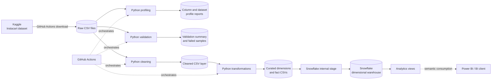
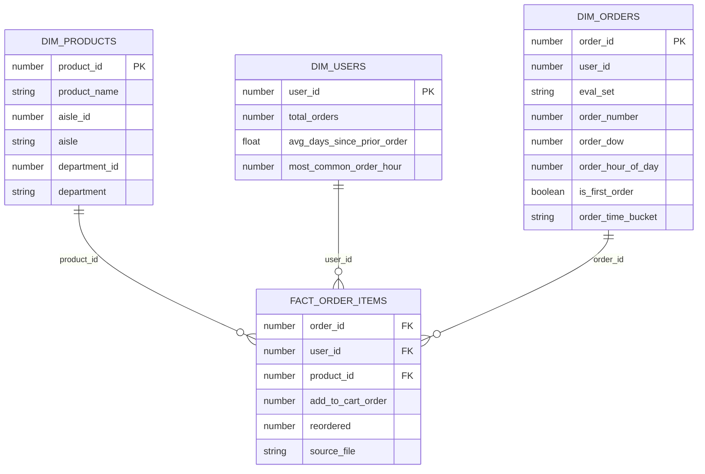

# Instacart Retail Analytics Platform

[](https://www.python.org/)
[](https://pandas.pydata.org/)
[](https://www.snowflake.com/)
[](https://github.com/features/actions)

An end-to-end retail analytics pipeline that profiles, validates, cleans, and models the Instacart Market Basket Analysis dataset before loading a dimensional warehouse in Snowflake. The platform supports product performance, reorder behavior, basket analysis, customer ordering patterns, and time-of-day reporting.

> **Data notice:** this project uses the public Instacart market-basket dataset. No private customer, payment, address, or personally identifying information is included in this repository. Raw and curated bulk datasets are excluded from Git.

## Problem statement

Online grocery order data is distributed across orders, products, aisles, departments, and separate prior/train order-item files. In its source form, the dataset is useful for experimentation but not ready for governed analytics:

- source files need measurable profiling and schema validation;
- order-item history must be combined without losing source context;
- product, order, and user attributes need consistent analytical grains;
- warehouse loads must reconcile with curated files;
- analysts need reusable views instead of repeatedly rebuilding complex joins.

This project turns those raw files into a quality-controlled dimensional model that answers:

1. Which products, aisles, and departments generate the most activity?
2. Which products have the strongest reorder behavior?
3. How do basket size and reorder rate vary by weekday and hour?
4. How frequently do users order, and when do they typically shop?
5. Can every warehouse row be reconciled to its curated source?

## Architecture



### End-to-end flow

| Stage | Component | Responsibility | Output |
|---|---|---|---|
| Acquire | Kaggle CLI | Downloads six source CSVs using a repository secret | Raw source files |
| Profile | Python and Pandas | Measures shape, types, nulls, duplicates, cardinality, samples, and memory | Profiling reports |
| Validate | Rule-driven Python framework | Checks keys, ranges, allowed values, composite uniqueness, and relationships | Rule summary and failed samples |
| Clean | Python and Pandas | Standardizes names, trims text, removes exact duplicates, and enforces numeric types | Cleaned datasets |
| Transform | Modular Python builders | Creates natural-grain dimensions and fact records | Four curated CSV files |
| Load | Snowflake connector and internal stage | Uses `PUT` and `COPY INTO` after truncating targets | Snowflake analytical tables |
| Verify | Snowflake quality framework | Reconciles counts, keys, relationships, and allowed values | Persisted QA results |
| Serve | Snowflake views | Publishes product, user, order-item, and time analytics | BI-ready semantic layer |

## Source data

The pipeline downloads the [Instacart Online Grocery Basket Analysis dataset](https://www.kaggle.com/datasets/yasserh/instacart-online-grocery-basket-analysis-dataset).

| Dataset | Grain | Profiled rows | Purpose |
|---|---|---:|---|
| `orders` | One order | 3,421,083 | User, sequence, weekday, hour, and order-set context |
| `products` | One product | 49,688 | Product-to-aisle and product-to-department mapping |
| `aisles` | One aisle | 134 | Aisle reference data |
| `departments` | One department | 21 | Department reference data |
| `order_products__prior` | One product line in a prior order | 32,434,489 | Historical basket activity |
| `order_products__train` | One product line in a training order | 1,384,617 | Training basket activity |

The two order-product sources contain **33,819,106** combined product-line records before downstream transformation.

## Pipeline design

### 1. Profiling

The profiling framework processes every required source and creates:

- column reports with type, row count, null count and percentage, duplicate count, distinct count, and samples;
- dataset reports with row count, column count, duplicate rows, and memory usage;
- execution logs for operational traceability.

Committed profile summaries provide a lightweight source audit without versioning the raw bulk files.

### 2. Validation

Validation is configuration-driven through `python_etl/validation/validation_rules.py`. The current framework evaluates **50 rules**, and the committed summary records all 50 as passing.

Controls include:

- not-null, positive-value, and uniqueness constraints;
- weekday range `0–6` and order-hour range `0–23`;
- allowed `eval_set` and binary `reordered` values;
- composite uniqueness of `order_id + product_id`;
- conditional null handling for first orders;
- product-to-aisle and product-to-department integrity;
- prior/train order-item integrity against the appropriate order subsets.

Failures are not hidden. The pipeline writes a rule-level summary and representative failed records with timestamps.

### 3. Cleaning

Cleaning applies a deterministic sequence to all six sources:

1. standardize column names;
2. trim text values;
3. remove exact duplicate rows;
4. coerce configured integer columns to nullable integers;
5. coerce configured decimal columns to numeric values;
6. write cleaned data and a cleaning summary.

The summary records original and cleaned shapes, removed duplicates, output location, and execution time.

### 4. Curated transformations

Separate modules build each analytical object. Prior and train order items are unioned with a `source_file` field before order context is joined, preserving lineage in the fact table.

## Data model



| Warehouse object | Grain | Key analytical content |
|---|---|---|
| `DIM_PRODUCTS` | One product | Product, aisle, and department hierarchy |
| `DIM_USERS` | One user | Order frequency, cadence, first/last order, and preferred hour |
| `DIM_ORDERS` | One order | Sequence, weekday, hour, first-order flag, and time bucket |
| `FACT_ORDER_ITEMS` | One product line per order | Basket position, reorder flag, dimension keys, and source set |

The fact table deliberately keeps order-item grain. Order metrics use `COUNT(DISTINCT order_id)`, while item activity uses `COUNT(*)`, preventing basket lines from being mistaken for orders.

## Snowflake warehouse

The Snowflake implementation contains:

- database `INSTACART_ANALYTICS` and schema `ANALYTICS`;
- internal stage `CURATED_INTERNAL_STAGE`;
- a named CSV format with explicit null and quoting behavior;
- three dimensions and one fact table;
- four reusable analytical views.

Curated loads use a controlled full-refresh pattern:

```text
TRUNCATE target → PUT curated CSV → COPY INTO target → validate row count
```

`COPY INTO` uses `ON_ERROR = 'ABORT_STATEMENT'`, so malformed warehouse loads fail instead of partially succeeding.

### Analytics views

| View | Purpose |
|---|---|
| `VW_ORDER_ITEM_ANALYTICS` | Denormalized order-line detail with product hierarchy, day name, and time bucket |
| `VW_PRODUCT_PERFORMANCE` | Orders, users, reorder rate, and average cart position by product |
| `VW_USER_ORDER_BEHAVIOR` | Basket size, reorder behavior, and order cadence by user |
| `VW_ORDER_TIME_ANALYTICS` | Orders, items, users, basket size, and reorder rate by weekday/hour |

All rate calculations use `NULLIF` guards to avoid division by zero.

## Data quality

Quality is evaluated before and after warehouse loading.

### Pre-warehouse controls

- all six files are required before processing;
- profiling exposes nulls, duplicates, and cardinality;
- primary and composite keys are validated;
- categorical and range constraints are explicit;
- cross-file referential integrity is checked;
- failed samples and rule summaries are persisted;
- cleaning metrics expose row-count changes.

### Snowflake controls

The warehouse suite performs **11 checks**, all passing in the committed result:

- curated CSV and Snowflake row counts match for all four tables;
- primary keys are unique in all dimensions;
- every fact product, order, and user resolves to its dimension;
- `reordered` contains only `0` or `1`.

Any failed warehouse check raises an exception and prevents the run from being reported as successful.

## CI/CD automation

The GitHub Actions workflow runs on pushes to `main` and manual dispatch:

1. checks out the repository;
2. configures Python 3.11;
3. installs ETL dependencies;
4. creates runtime directories;
5. downloads data using `KAGGLE_API_TOKEN` from GitHub Secrets;
6. runs profiling, validation, cleaning, and transformation;
7. uploads reports, outputs, and logs as workflow artifacts.

Snowflake credentials are not stored in source control. The workflow automates Python ETL; Snowflake creation and loading are invoked separately with environment-based credentials.

## Setup and execution

### Prerequisites

- Python 3.11
- Kaggle API access
- Snowflake account and role with object-creation and load permissions

```bash
python -m venv .venv
source .venv/bin/activate
pip install pandas numpy kaggle python-dotenv snowflake-connector-python
```

### Configure credentials

```bash
cp .env.example .env
```

Populate the Snowflake variables in `.env`; never commit that file. For GitHub Actions, add `KAGGLE_API_TOKEN` under **Settings → Secrets and variables → Actions**.

### Run the Python ETL

After placing the six CSV files in `python_etl/data/raw/`:

```bash
python -m python_etl.pipeline.run_pipeline
```

### Build and load Snowflake

Execute the SQL definitions in dependency order:

1. `create_database.sql`
2. `create_schema.sql`
3. `create_stage_and_file_format.sql`
4. `create_dimensions.sql`
5. `create_facts.sql`
6. `create_analytics_views.sql`

Then load curated data and run warehouse checks:

```bash
python -m python_etl.snowflake.load_curated_tables
python -m python_etl.snowflake.quality_checks
```

## BI serving layer

The four Snowflake views form the semantic serving layer for Power BI or another SQL-capable BI client. A Power BI project and dashboard screenshots are not currently committed, so this README documents the verified view contracts without presenting an unversioned dashboard as complete.

Recommended report pages are product/department performance, customer order cadence, weekday/hour demand, reorder behavior, and warehouse quality.

## Repository structure

```text
.github/workflows/          GitHub Actions ETL orchestration
config/                     Paths, source registry, and Snowflake environment config
documentation/              Design and validation notes
python_etl/profiling/       Source profiling framework
python_etl/validation/      Rules, validation engine, and reports
python_etl/cleaning/        Standardization, typing, and duplicate handling
python_etl/transformation/  Dimension and fact builders
python_etl/snowflake/       Connections, DDL, loading, QA, and views
python_etl/data/            Lightweight profiling and quality outputs
```

## Current implementation status

| Capability | Status |
|---|---|
| Source profiling | Implemented |
| Rule-driven validation | Implemented |
| Cleaning and curated transformations | Implemented |
| GitHub Actions Python ETL | Implemented |
| Snowflake tables, stage, loads, and QA | Implemented |
| Snowflake analytics views | Implemented |
| Power BI report artifact | Not committed |
| Automated unit-test suite | Not currently included |

## License and dataset usage

This repository is an educational and portfolio project. Review the source dataset’s Kaggle terms before redistribution or commercial use, and add an explicit software license before publishing this code as a reusable package.
